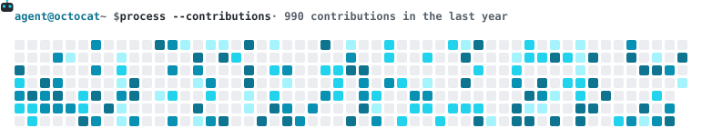

# Agent Cards

**Animated SVG cards for your GitHub profile README.** A small robot walks your contribution graph and lights up every active day. Next to it, a terminal-style panel shows the systems you run in production.

<picture></picture>

<picture></picture>

- Zero dependencies, no build step. A GitHub Action that runs plain Node.
- One SVG adapts to light and dark mode through `prefers-color-scheme`.
- Respects `prefers-reduced-motion`.
- The contribution card works with no config at all.

## Quick start

1. In your profile repository (`<username>/<username>`), add `.github/workflows/agent-cards.yml`:

   ```yaml
   name: Update agent cards
   on:
     schedule:
       - cron: "0 3 * * *"
     workflow_dispatch:
   concurrency:
     group: agent-cards
     cancel-in-progress: false
   permissions:
     contents: write
   jobs:
     render:
       runs-on: ubuntu-latest
       steps:
         - uses: actions/checkout@v4
         - uses: humberto325/github-agent-cards@v1
           with:
             github_token: ${{ secrets.GITHUB_TOKEN }}
             # config: agent-cards.config.json   # optional, enables the systems panel
         - run: |
             git config user.name "github-actions[bot]"
             git config user.email "41898282+github-actions[bot]@users.noreply.github.com"
             git add assets/agent-*.svg
             git diff --cached --quiet || { git commit -m "chore: update agent cards" && git pull --rebase -q && git push; }
   ```

2. Run it once from the **Actions** tab (`workflow_dispatch`).
3. Reference the cards in your `README.md`:

   ```markdown
   
   
   ```

The `concurrency` group and the `git pull --rebase` before `git push` stop two runs, or a run and your own push, from racing on the same branch. See [`examples/workflow.yml`](examples/workflow.yml).

## Inputs

| Input | Required | Default | Description |
|-------|----------|---------|-------------|
| `github_token` | yes | | Token used to read the contribution calendar. `secrets.GITHUB_TOKEN` is enough. |
| `username` | no | repository owner | Whose contributions to render. |
| `config` | no | | Path to a JSON config file. Without it, only the contribution card is rendered. |
| `output_dir` | no | `assets` | Where the SVG files are written. |

Output files: `agent-contrib.svg` and, when `cards` is set, `agent-panel.svg`.

## Configuration

Start from [`examples/agent-cards.config.json`](examples/agent-cards.config.json). All keys are optional.

| Key | Type | Default | Description |
|-----|------|---------|-------------|
| `theme.light.accent` / `theme.dark.accent` | hex color | `#0e7490` / `#22d3ee` | Accent for titles and prompts. The dark accent also drives the glow effects in both modes. |
| `theme.light.levels` / `theme.dark.levels` | 5 hex colors | cyan scale | Calendar colors, from no contributions to the most. |
| `command` | string | `systems --status production` | Text typed after `agent@<user> ~ $` in the panel. |
| `subtitle` | string | `{count} systems running right now` | Line under the prompt. `{count}` becomes the number of cards. |
| `contributions` | string | `{count} contributions in the last year` | Contribution card label. `{count}` becomes your total. |
| `cards` | array, 2–6 items | `[]` | `{ "title": string, "lines": [string, string?] }`. Laid out as a 2-column grid. Empty means no panel. |
| `footer` | array | `[]` | `{ "value": string, "label"?: string }`. Values use the accent color and labels are dimmed. |
| `languages` | object | `{}` | Localized copies. See below. |

```json
{
  "cards": [
    { "title": "Support assistant", "lines": ["Answers common questions in seconds", "and hands hard cases to a human."] },
    { "title": "Release bot", "lines": ["Builds, tests and tags every merge,", "then posts the changelog to chat."] }
  ],
  "footer": [{ "value": "12", "label": "workflows in production" }, { "value": "30K+", "label": "runs" }]
}
```

**Validation.** An invalid config fails the run with exit code 1 and lists every problem, for example `cards[2].lines must be an array of 1 or 2 strings` or `cards must have between 2 and 6 items (got 7)`. Text that will probably overflow its card only produces a warning. Each description line fits about 45 characters and each title about 39.

## Localization

Every key under `languages.<code>` overrides `command`, `subtitle`, `contributions`, `cards` or `footer` for that language. Anything you leave out is inherited. The default language keeps the plain file names, and each extra language gets a suffix:

```json
{ "languages": { "es": { "contributions": "{count} contribuciones en el último año", "subtitle": "{count} sistemas corriendo ahora mismo" } } }
```

That produces `agent-contrib.es.svg` (and `agent-panel.es.svg` when there are cards) alongside the English files.

## Accessibility

- Each SVG has `role="img"`, an `aria-label` and a `<title>` that carry the full text content.
- With `prefers-reduced-motion: reduce`, the robot, beams, radar rings, data packets, scanline and typing covers are hidden. The full calendar and all text are shown statically.

## How it works

1. One GraphQL query fetches your contribution calendar.
2. Active days are sorted chronologically. Each one gets its own `step-end` keyframe that lights it up when the robot arrives, and the robot's `walk` keyframes visit the cells in the same order. The loop lasts 12–40 s, depending on how many days are active, and resets the board in its last 5%.
3. The panel's typing reveal uses background-colored rectangles that scale on the X axis. `clip-path` on SVG text stalls in some renderers. Staggered elements use `animation-fill-mode: backwards` so they stay hidden until their delay ends.
4. All user text is XML-escaped, and colors must be hex values because they are injected into CSS.

Rendering is pure: `src/render.mjs` takes data and returns SVG strings. Run `npm test` (Node's built-in `node:test`, no network) and `npm run demo` to regenerate `docs/`.

Run it locally:

```bash
GH_TOKEN=$(gh auth token) node src/index.mjs <username> [config.json] [output_dir]
```

## License

[MIT](LICENSE) © 2026 Humberto Rivero
